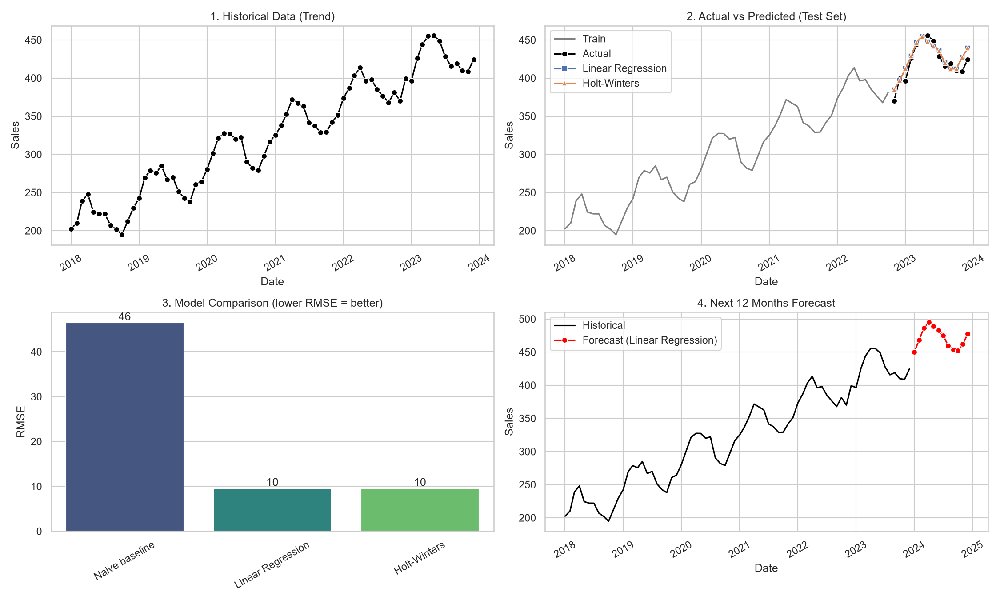

# Predictive Analytics Using Historical Data

Forecasting future monthly sales from historical Superstore data using regression and time-series models.

## Problem Statement
Use past sales data to predict the next 12 months of sales, so a business can plan inventory and targets.

## Dataset
- **Superstore Sales** (`train.csv`), 9,800 orders, Jan 2015 to Dec 2018
- Columns used: `Order Date`, `Sales`
- Orders were aggregated into **48 monthly sales values**

## Project Files
| File | Purpose |
|---|---|
| `train.csv` | Raw dataset |
| `prepare_superstore.py` | Converts daily orders into monthly sales (`monthly_sales.csv`) |
| `predictive_analytics.py` | Cleaning, modelling, evaluation, visualization, forecast |
| `monthly_sales.csv` | Monthly aggregated data |
| `forecast_plot.png` | Output graphs |
| `future_forecast.csv` | 12-month forecast for 2019 |

## Methodology
1. **Preprocessing**: parsed dates (dd/mm/yyyy), removed duplicates, handled missing values by time interpolation, checked outliers with the IQR method, aggregated to monthly totals.
2. **Train/test split**: time-based (last 20% of months as test set, no shuffling).
3. **Models**
   - Linear Regression (time trend + month-of-year seasonality)
   - Holt-Winters Exponential Smoothing (additive trend and seasonality)
   - Naive baseline (last observed value) for comparison
4. **Evaluation metrics**: MAE, RMSE, MAPE
5. **Forecast**: best model (lowest RMSE) retrained on all data and used to predict the next 12 months.

## Results
| Model | MAE | RMSE | MAPE |
|---|---|---|---|
| Naive baseline | 21,796 | 26,375 | 32.7% |
| Linear Regression | 11,535 | 15,205 | 16.5% |
| **Holt-Winters (best)** | 11,966 | **13,282** | 19.5% |

Both models clearly beat the naive baseline. Holt-Winters had the lowest RMSE and was used for the 2019 forecast.

## Visualizations


1. Historical sales trend
2. Actual vs predicted on the test set
3. Model comparison (RMSE)
4. 12-month future forecast

## Key Insights
- Sales show an upward trend over the four years.
- Strong seasonality: sales peak in Sep to Dec (year-end) and dip in early months.
- The forecast predicts this seasonal pattern to continue in 2019.

## Limitations
- Only 4 years (48 points) of data, so predictions carry noticeable error (MAPE about 16 to 20%).
- Promotions, regions and product categories were not modelled.
- Future work: try ARIMA/SARIMA, Prophet, add external features, per-category forecasts.

## How to Run
```
pip install pandas numpy matplotlib seaborn scikit-learn statsmodels
python prepare_superstore.py
python predictive_analytics.py monthly_sales.csv Date Sales
```

## Tools
Python, pandas, NumPy, scikit-learn, statsmodels, matplotlib, seaborn
